<picture>
  <source media="(prefers-color-scheme: dark)" srcset="./dark.svg">
  <source media="(prefers-color-scheme: light)" srcset="./light.svg">
  
</picture>

 

### Hi, I'm Raj.

I'm a full-stack / software developer based in Pune, India. I work mostly in JavaScript: **React** on the front end, **Node.js + Express** on the back end, with **MongoDB** and **MySQL** for data. I graduated in 2023 with a B.E. in Computer Engineering.

 

## Focus

- **React interfaces:** dashboards, admin panels and drag-and-drop flow editors
- **REST APIs:** Node.js + Express services with MongoDB, JWT auth and route-level middleware
- **Data-heavy UIs:** monitoring views, embedded Metabase dashboards and IoT sensor dashboards

 

## Featured Projects

| Project | What it is | Built with |
| :-- | :-- | :-- |
| [**etl-tool-ui**](https://github.com/RajShimpi/etl-tool-ui) | Front end for a team-built ETL platform: drag-and-drop job flows, job and step parameter masters, monitoring logs, embedded Metabase dashboards and an IoT sensor dashboard (temperature, humidity, pressure, wind speed) | React · MUI · React Flow · Zustand · React Hook Form + Yup · Socket.IO client |
| [**E-Commerce-App-MERN**](https://github.com/RajShimpi/E-Commerce-App-MERN) | E-commerce back end: user registration and login, JWT auth middleware, error handling, and user management with block / unblock | Node.js · Express · MongoDB (Mongoose) · JWT · bcrypt |
| [**PortFolioAdmin**](https://github.com/RajShimpi/PortFolioAdmin) | Admin dashboard with a register → OTP verification → login flow against a REST API, plus sidebar navigation and data tables | React · React Router · Axios · styled-components · Bootstrap |
| [**NewsApp**](https://github.com/RajShimpi/NewsApp) · [live](https://news-app-alpha-bice.vercel.app) | News reader with category routes (business, tech, science, sports and more), infinite scroll and a top loading bar | React · React Router |
| [**E-Distributor**](https://github.com/RajShimpi/E-Distributor) | Web app for booking electronics services and buying products: customer accounts, cart, orders and an admin area | PHP · MySQL · JavaScript |
| [**Weather-App**](https://github.com/RajShimpi/Weather-App) | Current-location weather and forecast with a live clock and animated weather icons | React · Axios |

**Smaller React builds:** [Social Media Dashboard](https://github.com/RajShimpi/Social-Media-DashBorad-React-JS) · [Todo List](https://github.com/RajShimpi/Todo-List) · [Pomodoro Timer](https://github.com/RajShimpi/Pomodoro-Timer) · [Password Generator](https://github.com/RajShimpi/Password-Genrater) · [GitHub Profile Card](https://github.com/RajShimpi/GitHub-Profile-Card)

 

## Engineering Stack

| | |
| :-- | :-- |
| **Languages** | JavaScript · PHP · SQL · HTML · CSS |
| **Frontend** | React · React Router · MUI · styled-components · Bootstrap · React Flow · Zustand · React Hook Form + Yup |
| **Backend** | Node.js · Express · REST APIs · JWT / bcrypt auth |
| **Data** | MongoDB (Mongoose) · MySQL |
| **Tools** | Git · GitHub · GitLab · npm · Vercel |
| **Also familiar with** | Tailwind CSS · NestJS · Laravel · Inertia.js · Java · C · C++ · Oracle |

 

## Education

**B.E. Computer Engineering**, North Maharashtra University, Jalgaon · 2023

 

## Connect

[GitHub](https://github.com/RajShimpi) · [LinkedIn](https://www.linkedin.com/in/raj-shimpi-892b8b253) · [X](https://x.com/RajShimpi12)
